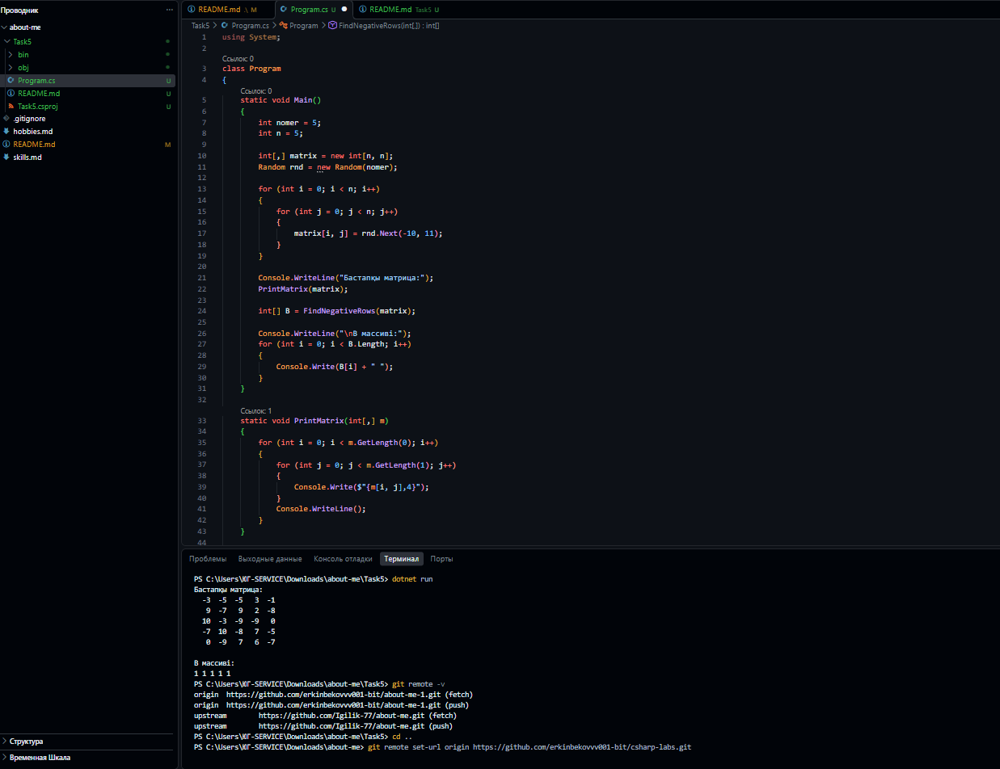

# 5-тапсырма: Екі өлшемді массивтер (2-нұсқа)

**Аты-жөні:** Еркінбек Алмахан  
**Тобы:** ИС-21  
**Тізімдегі нөмірі:** 5

## Тапсырма

5×5 өлшемді матрица құру. Егер i-жолда кемінде бір теріс элемент болса, B[i] = 1, әйтпесе B[i] = 0.

## Тест нәтижелері

| Тест | Кіріс | Қолмен есептеген жауап | Бағдарлама жауабы |
|---|---|---|---|
| Жеке тест | Random(5) | Нәтижені есептеу керек | Нәтижені енгізу керек |
| Өз тестім 1 | Кейін енгізіледі | Кейін есептеледі | Кейін енгізіледі |
| Өз тестім 2 | Кейін енгізіледі | Кейін есептеледі | Кейін енгізіледі |

## Сұрақтарға жауап

**1. matrix[i, j] жазбасында i мен j нені білдіреді? GetLength(0) және GetLength(1) не қайтарады?**

i – жол нөмірі, j – баған нөмірі. GetLength(0) жол санын, ал GetLength(1) баған санын қайтарады.

**2. Жолда теріс элемент табылғаннан кейін ішкі циклді жалғастыру керек пе? break не береді?**

Теріс элемент табылғаннан кейін ішкі циклді жалғастыру қажет емес. break командасы циклді тоқтатады, ал келесі жолды тексеру жалғасады.

**3. Кодыңыздағы ішкі цикл неше рет орындалады?**

Матрица 5×5 болғандықтан, ішкі цикл ең көбі 25 рет орындалады. FindNegativeRows методында теріс элемент табылған кезде break арқылы ерте тоқтайды.

## ЖИ қолдану

ЖИ-ден 5×5 матрицаны өңдеу және әр жолдағы теріс элементтерді анықтау әдісін түсіндіруді сұрадым. Ұсынылған кодты өз жобама енгізіп, айнымалылар мен циклдердің жұмысын тексердім.